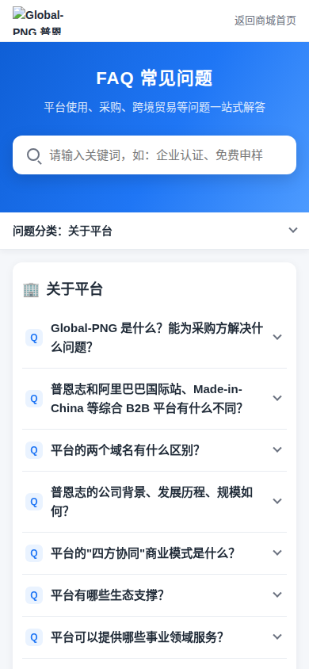
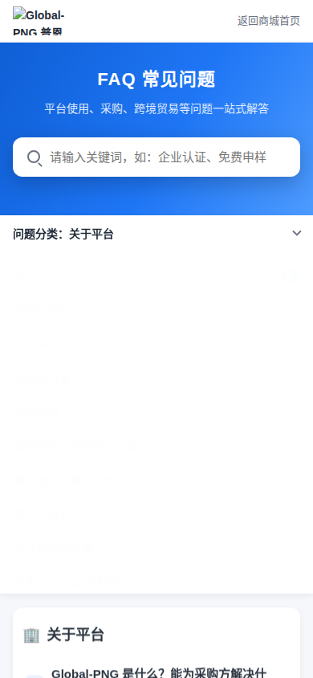
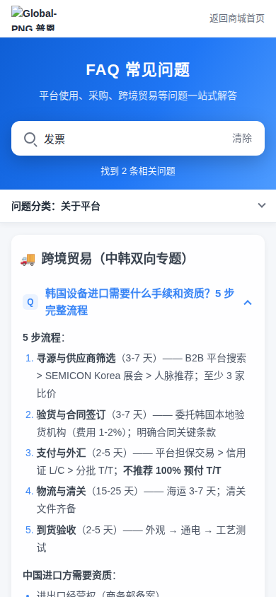

# Global-PNG FAQ 页面 自测文档

- 版本：2026.10.29（根据《Global-PNG FAQ 项目问题清单》修改后）
- 自测日期：2026-10-29
- 交付内容：`index.html`、`css/`、`js/`、`assets/`（纯 HTML + CSS + 原生 JS，无框架、无后端）

## 一、测试环境

| 项目 | 环境 | 结果 |
|---|---|---|
| Chrome 内核 | Chromium（Playwright 自动化测试，与 Chrome 同内核） | ✅ 78/78 项通过，控制台无报错 |
| 分辨率 | 1920×1080、1440×900、768×1024（平板）、390×844（手机） | ✅ 均无横向滚动条 |
| Microsoft Edge | 与 Chrome 同为 Chromium 内核，预期一致 | ⬜ 待实机确认 |
| 微信内置浏览器 | Android / iOS 微信内打开 | ⬜ 待手机确认 |
| 本地直接打开 | 双击 `index.html`（file:// 协议） | ✅ 可正常运行（Logo、favicon 引用主站地址，需联网显示） |

## 二、功能检查表（每个分辨率各执行一遍）

| # | 检查项 | 预期结果 | 结果 |
|---|---|---|---|
| 1 | 页面渲染 | 左侧 10 个分类（含问题数），右侧 58 条问题 | ✅ |
| 2 | 默认状态 | 所有问题默认收起（答案高度为 0） | ✅ |
| 3 | 展开 / 收起动画 | 点击问题后答案平滑展开（0.3 秒），再次点击平滑收起；箭头旋转；`aria-expanded` 同步 | ✅ |
| 4 | 分类跳转 | 点击左侧分类，平滑滚动到对应分类 | ✅ |
| 5 | 滚动联动 | 滚动时当前分类自动高亮；移动端按钮文字同步 | ✅ |
| 6 | 搜索中状态 | 输入时搜索框右侧显示加载圈，下方显示“搜索中…” | ✅ |
| 7 | 搜索结果 | 停止输入 0.3 秒（或回车）后筛选；匹配问题展开、关键词高亮、显示“找到 N 条相关问题”，结果卡片淡入 | ✅ |
| 8 | 提示文字不挤动布局 | 搜索提示区域固定占位，只做淡入淡出，下方内容位置不变 | ✅ |
| 9 | 搜索无结果 / 清除 | 显示“没有找到相关问题”；点击“清除”恢复全部问题 | ✅ |
| 10 | 搜索安全 | 高亮只处理文字节点，链接不被破坏；输入 HTML 代码不会被执行 | ✅ |
| 11 | 功能链接 | 答案中 12 处功能名称为链接，当前窗口跳转 | ✅ |
| 12 | 回到顶部 | 滚动超过一屏后淡入，点击平滑回到顶部 | ✅ |
| 13 | URL 直达问题 | `index.html#q-about-01` 自动展开、定位并高亮 2 秒；页面内修改 `#q-cross-05` 同样有效 | ✅ |
| 14 | URL 直达分类 | `index.html#cross` 定位到分类 | ✅ |
| 15 | PC / 移动端切换 | > 768px 左侧导航；≤ 768px 顶部吸顶分类菜单（展开动画） | ✅ |
| 16 | 移动端分类菜单 | 展开列表，选择分类后跳转并自动收起，标题不被吸顶菜单遮挡 | ✅ |
| 17 | 表格 | 手机上表格可横向滑动，不撑破页面 | ✅ |
| 18 | 减少动态效果 | 系统开启“减少动态效果”时动画自动关闭 | ✅（CSS 已处理） |

## 三、问题清单处理结果

| 编号 | 问题 | 处理结果 |
|---|---|---|
| 2.1 | 4 条答案内容丢失 | 对照原页面源码确认：**原页面本身即为空或不完整**。按要求删除答案为空的 `q-about-05`、`q-order-01`；删除 `q-pay-01`、`q-pay-05` 中没有内容的小标题 |
| 2.2 | 关于平台 8 条机翻 | 已全部替换为原页面中文原文（`q-about-01`~`08`），并修正原文中重复的“合肥” |
| 2.3 | 表格表头缺失 | 原页面也只有第一列表头，已根据表格内容补齐：`q-about-02`（维度/普恩志/综合 B2B 平台）、`q-product-03`（方式/速度/匹配精准度/适用场景）、`q-supplier-03`（级别/广告位/基础会员/标准会员/战略会员） |
| 3.1 | 14 个功能链接为空 | 13 个已按主站路由填写；`supplierJoin`（供应商入驻）待确认 |
| 3.2 | 页脚 4 个按钮为空 | 在线客服、免费申样、国产替代专区已填写；供应商入驻待确认 |
| 4.1 | 主色为临时色 | 已改为主站品牌蓝 `#1f76f5`，正文色、浅蓝背景、分隔线也与主站一致 |
| 4.2 | 无 Logo | 新增顶部品牌栏，使用主站 Logo，点击返回商城首页 |
| 4.3 | 无 assets 目录 | 已创建 `assets/`（Logo 当前直接引用主站图片地址，与主站同步更新） |
| 5.1 | 注释为韩文 | `faq.js`、`faq.css`、`faq-data.zh.js`、`index.html` 注释已全部改为中文 |
| 5.2 | 无版本号 | CSS / JS 引用已加 `?v=20261029` |
| 补充 | 样式生硬、无动画 | 问题展开/收起动画、搜索加载圈与“搜索中…”提示、结果淡入、提示文字固定占位、按钮/导航悬停过渡、回到顶部与移动端菜单动画 |
| 5.3 | 缺少 SEO 信息 | 已加 description、keywords、Open Graph、favicon |

## 四、仍需确认

1. “供应商入驻”页面地址（主站路由中未找到，可能是外部页面）。
2. 以下 3 个链接需登录后确认页面是否对应：账户安全 `/member/account`、关注中心 `/member/collect`、财务 `/member/invoice`。
3. Edge、微信（Android / iOS）实机检查。
4. 部署位置（替换现有 `/act/pngFAQ.html` 或新建页面）。

## 五、部署说明

1. 将 `index.html`、`css/`、`js/`、`assets/` **保持目录结构**上传到同一目录（FTP 即可，无需服务器配置）。
2. 所有路径均为相对路径；如替换现有页面，可将 `index.html` 改名为 `pngFAQ.html` 上传到 `/act/` 目录。
3. 修改 CSS / JS 后，同步修改 `index.html` 中的 `?v=` 版本号。
4. 上传后检查：页面正常显示、Logo 正常、`页面地址#q-order-03` 可直达、手机微信打开布局正常。

## 六、内容维护说明

- **修改问答**：只改 `js/faq-data.zh.js`。`q` 为问题文字；`a` 为答案 HTML（`
`、` `、`<ul><li>`、`<ol><li>`、`<table>`、`<strong>`）；`[[key]]` 为功能链接。
- **新增问题**：在对应分类 `items` 中追加，id 按 `q-分类-序号` 继续编号，不修改已有 id。
- **功能链接**：在 `FAQ_LINKS` 中修改 `url`，并同步《FAQ跳转映射表》。
- **其他语言版本**：复制 `faq-data.zh.js` 为 `faq-data.ko.js` 并翻译（含 `ui` 中的提示文案），再复制 `index.html` 修改固定文字和 `<script src>`，`faq.js`、`faq.css` 无需修改。

## 七、截图

| PC 1440（新样式） | 搜索中状态 |
|---|---|
|  |  |

| 手机 390 | 移动端分类菜单 | 搜索结果 |
|---|---|---|
|  |  |  |
