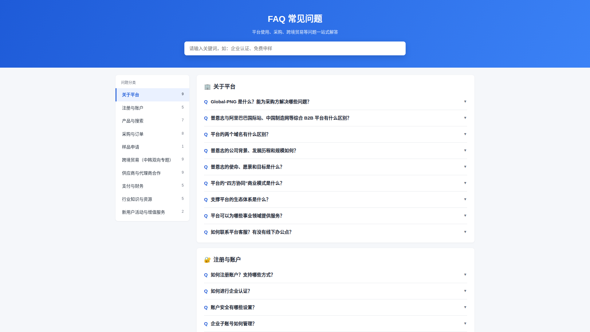
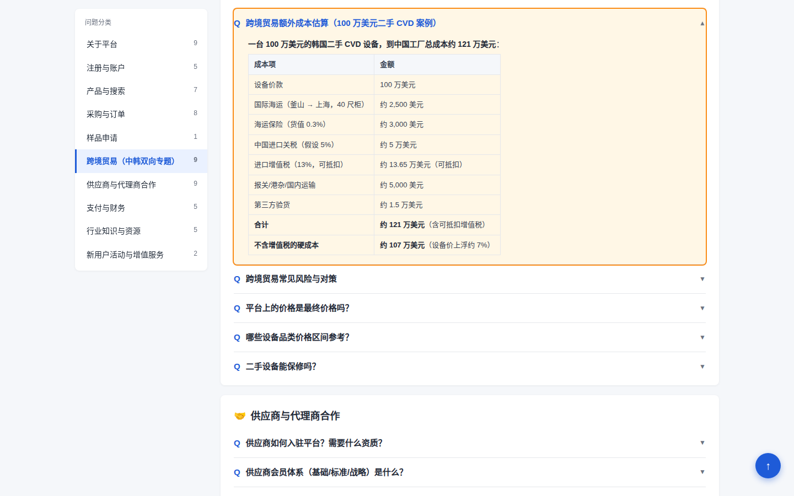

# Global-PNG FAQ 页面 自测文档

- 版本：2026.10
- 自测日期：2026-10-27
- 交付内容：`index.html`、`css/`、`js/`、`assets/`（纯 HTML + CSS + 原生 JS，无框架、无后端）

## 一、测试环境

| 项目 | 环境 | 结果 |
|---|---|---|
| Chrome 内核 | Chromium（Playwright 自动化测试，与 Chrome 同内核） | ✅ 已测，66/66 项通过，控制台无报错 |
| 分辨率 | 1920×1080、1440×900、768×1024（平板）、390×844（手机） | ✅ 均无横向滚动条 |
| Microsoft Edge | 与 Chrome 同为 Chromium 内核，预期一致 | ⬜ 待在实机上确认 |
| 微信内置浏览器 | Android / iOS 微信内打开 | ⬜ 待在手机上确认 |
| 本地直接打开 | 双击 `index.html`（file:// 协议） | ✅ 可正常运行（数据为 JS 文件，不依赖 fetch） |

## 二、功能检查表

> 每个分辨率都执行一遍，以下为 4 个分辨率汇总结果。

| # | 检查项 | 预期结果 | 结果 |
|---|---|---|---|
| 1 | 页面渲染 | 左侧 10 个分类（含问题数），右侧 60 条问题 | ✅ |
| 2 | 默认状态 | 所有问题默认折叠 | ✅ |
| 3 | 折叠展开 | 点击问题展开 / 再次点击收起，各问题互不影响；`aria-expanded` 同步 | ✅ |
| 4 | 分类跳转 | 点击左侧分类，平滑滚动到对应分类 | ✅ |
| 5 | 滚动联动 | 滚动时左侧当前分类自动高亮；移动端按钮文字同步 | ✅ |
| 6 | 搜索 | 输入关键词（如"发票"），0.3 秒后筛选；匹配问题自动展开，关键词高亮，显示"找到 N 条相关问题" | ✅ |
| 7 | 搜索无结果 | 输入无关词，显示"没有找到相关问题" | ✅ |
| 8 | 清除搜索 | 点击"清除"，恢复全部 60 条、清除高亮、隐藏提示 | ✅ |
| 9 | 搜索安全 | 高亮只处理文字节点，不改动 HTML 标签；链接不被破坏 | ✅ |
| 10 | 功能链接 | 答案中的功能名称在填写 URL 后显示为链接，当前窗口跳转；URL 为空时只显示文字 | ✅（URL 待填写） |
| 11 | 回到顶部 | 向下滚动超过一屏后出现，点击平滑回到顶部 | ✅ |
| 12 | URL 直达问题 | 打开 `index.html#q-about-01`：自动展开该问题、滚动到位置并高亮 2 秒 | ✅ |
| 13 | 页面内锚点变化 | 地址改为 `#q-cross-05`（hashchange）也能直达 | ✅ |
| 14 | URL 直达分类 | `index.html#cross` 定位到分类 | ✅ |
| 15 | PC / 移动端切换 | 宽度 > 768px 显示左侧导航；≤ 768px 显示顶部"问题分类"按钮 | ✅ |
| 16 | 移动端分类菜单 | 点击按钮展开列表，选择分类后跳转并自动收起 | ✅ |
| 17 | 表格 | 答案中的表格在手机上可横向滑动，不撑破页面 | ✅ |
| 18 | ID 唯一 | 页面中所有 id 不重复 | ✅ |

## 三、内容检查

| 项目 | 状态 | 说明 |
|---|---|---|
| 分类 / 问题数量 | ✅ | 10 个分类、60 条问题，与原页面一致 |
| 答案排版 | ✅ | 原页面中连在一起的"- 项目""1. 项目"已整理为列表；每句一行，段落之间空一行，小标题下方紧接列表 |
| 表格表头 | ⚠️ | 原数据只保留了第一列表头，已补齐；`q-product-03`、`q-supplier-03` 有部分列名无法确定（留空），需核对 |
| 关于平台 q-about-01 ~ 08 | ⚠️ | 保存原页面时被浏览器自动翻译成韩文，已回译为中文，**需与原页面原文核对** |
| q-about-05（使命、愿景、目标） | ❌ | 原答案内容丢失，需从原页面补充 |
| q-order-01（订单状态流转） | ❌ | 状态流程图丢失，需补充 |
| q-pay-01 / q-pay-05 | ❌ | 各有一个小标题下的内容丢失，需补充 |
| 改版后新增功能 | ⬜ | 需实际操作商城，整理新增功能点并补充问答 |
| 功能页面 URL（14 个） | ⬜ | 见《FAQ跳转映射表》，需登录平台逐一确认 |
| 页脚联系方式 | ✅ | 采用原 FAQ"联系平台"中的客服热线 400-8759987 和邮箱 Global@global-png.com |
| 页脚快捷按钮（4 个） | ⬜ | 目标地址待确认 |
| 主色 / Logo | ⬜ | 目前为临时蓝色 `#1e5bd8`，需按主站视觉规范替换（`css/faq.css` 顶部 `:root`） |

> 需确认的问题在 `js/faq-data.zh.js` 中带有 `"todo"` 字段，搜索 `todo` 即可找到。

## 四、部署说明

1. 将 `index.html`、`css/`、`js/`、`assets/` **保持目录结构**上传到同一目录（FTP 即可，无需服务器配置）。
2. 所有路径均为相对路径；如需替换现有页面，可将 `index.html` 改名为 `pngFAQ.html` 上传到 `/act/` 目录。
3. 上传后检查：
   - 打开页面，确认分类和问题正常显示；
   - 打开 `页面地址#q-order-03`，确认能直达问题；
   - 用手机微信打开一次，确认移动端布局。
4. 更新缓存：修改 CSS / JS 后若浏览器仍显示旧版，可在 `index.html` 引用处加版本号，例如 `js/faq.js?v=20261027`。

## 五、内容维护说明

- **修改问答**：只改 `js/faq-data.zh.js`，不需要改 HTML / JS。
  - `q`：问题（纯文字）
  - `a`：答案（HTML，可用 `
`、`<ul><li>`、`<ol><li>`、`<table>`、`<strong>`）
  - `[[key]]`：功能链接，key 在文件顶部 `FAQ_LINKS` 中定义
- **新增问题**：在对应分类的 `items` 中追加，id 按 `q-分类-序号` 规则命名（如 `q-order-09`），不要改动已有 id（直达链接依赖 id）。
- **填写功能链接**：在 `FAQ_LINKS` 中填写 `url`，页面会自动生成链接。
- **多语言（韩文版）**：复制 `faq-data.zh.js` 为 `faq-data.ko.js` 并翻译内容（含 `ui.searchResult` 文案），再复制 `index.html` 修改页面固定文字和 `<script src>` 即可，`faq.js` 和 `faq.css` 无需修改。

## 六、截图

| PC 1920 | PC 1440（URL 直达 + 表格） |
|---|---|
|  |  |

| 手机 390 | 移动端分类菜单 | 搜索 |
|---|---|---|
|  |  |  |
